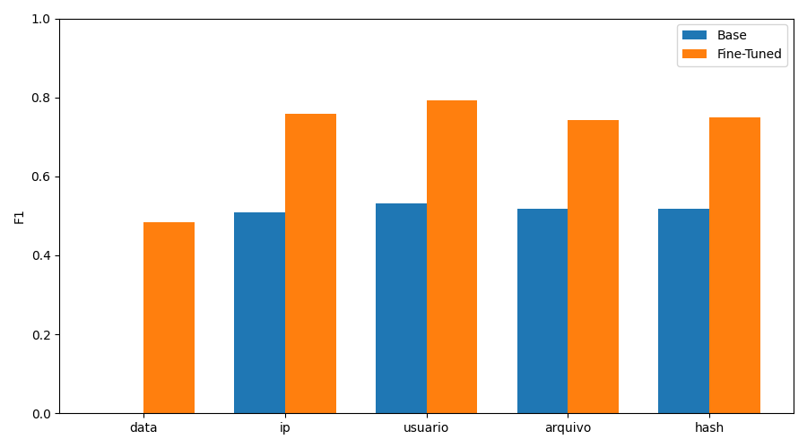

# Relatório de resultados

## Comparação Base vs Fine-Tuned

|---|---:|---:|
| Valid JSON sem limpeza | 80.000% | 83.333% |
| Valid JSON com limpeza | 83.333% | 83.333% |
| Schema válido | 53.333% | 83.333% |
| Micro-F1 | 40.892% | 70.253% |
| Macro-F1 | 41.535% | 70.549% |
| Exact Match | 3.333% | 53.333% |
| Taxa de alucinação | 0.806% | 0.000% |

## 10 primeiros casos do Fine-Tuned
### Caso 0

Entrada: `2026-12-08 19:45 src=89.165.172.98 usr=usuario_teste arquivo evidencia_33.pdf hash 49c5f7794e1dd4c786a2eb2618c1266f6a90663f`
Esperado: `[{"data":"2026-12-08 19:45","ip":"89.165.172.98","usuario":"usuario_teste","arquivo":"evidencia_33.pdf","hash":"49c5f7794e1dd4c786a2eb2618c1266f6a90663f"}]`
Previsto: `[{"data":"2026-12-08 19:45","ip":"89.165.172.98","usuario":"usuario_teste","arquivo":"evidencia_33.pdf","hash":"49c5f7794e1dd4c786a2eb2618c1266f6a90663f"}]`

### Caso 1

Entrada: `No dia 2026-08-28 às 20:00, o IP 123.18.203.169 acessou como usuário srv_backup arquivo relatorio_153.pdf hash 176494c0b1038094a7f66fff635c2444`
Esperado: `[{"data":"2026-08-28 20:00","ip":"123.18.203.169","usuario":"srv_backup","arquivo":"relatorio_153.pdf","hash":"176494c0b1038094a7f66fff635c2444"}]`
Previsto: `[{"data":"2026-08-28 20:00","ip":"123.18.203.169","usuario":"srv_backup","arquivo":"relatorio_153.pdf","hash":"176494c0b1038094a7f66fff635c2444"}]`

### Caso 2

Entrada: `2026-04-14 22:00 src=89.19.107.154 usr=usuario_teste arquivo backup_1140.pdf hash 8131f7bdf970106c0f1cc4dd43e3bb6a Depois registrou-se o próximo evento: 2026-12-02 13:30 src=151.3.59.106 usr=usuario_teste arquivo relatorio_1141.zip hash 71214e591ab794cf32286fb7e9b978a3`
Esperado: `[{"data":"2026-04-14 22:00","ip":"89.19.107.154","usuario":"usuario_teste","arquivo":"backup_1140.pdf","hash":"8131f7bdf970106c0f1cc4dd43e3bb6a"},{"data":"2026-12-02 13:30","ip":"151.3.59.106","usuario":"usuario_teste","arquivo":"relatorio_1141.zip","hash":"71214e591ab794cf32286fb7e9b978a3"}]`
Previsto: `[{"data":"2026-04-14 22:00","ip":"89.19.107.154","usuario":"usuario_teste","arquivo":"backup_1140.pdf","hash":"8131f7bdf970106c0f1cc4dd43e3bb6a"},{"data":"2026-12-02 13:30","ip":"151.3.59.106","usuario":"usuario_teste","arquivo":"relatorio_1141.zip","hash":"71214e591ab794cf32286fb7e9b978a3"}]`

### Caso 3

Entrada: `2026-07-08 09:05 src=129.186.190.216 usr=analista1 arquivo acesso_1040.zip hash 044b071ad0df99f2d74578387d6f3564 Depois registrou-se o próximo evento: 2026-06-06 12:30 src=50.38.110.5 usr=usuario_teste arquivo acesso_1041.zip hash cd977adf1d1938b8bd7a15101a69f83d Depois registrou-se o próximo evento: 2026-12-19 08:05 src=29.25.172.4 usr=usuario_teste arquivo acesso_1042.csv hash bb786c2343166e32a9f64146d8bbe3d2fd058491`
Esperado: `[{"data":"2026-07-08 09:05","ip":"129.186.190.216","usuario":"analista1","arquivo":"acesso_1040.zip","hash":"044b071ad0df99f2d74578387d6f3564"},{"data":"2026-06-06 12:30","ip":"50.38.110.5","usuario":"usuario_teste","arquivo":"acesso_1041.zip","hash":"cd977adf1d1938b8bd7a15101a69f83d"},{"data":"2026-12-19 08:05","ip":"29.25.172.4","usuario":"usuario_teste","arquivo":"acesso_1042.csv","hash":"bb786c2343166e32a9f64146d8bbe3d2fd058491"}]`
Previsto: `[{"data":"2026-07-08 09:05","ip":"129.186.190.216","usuario":"analista1","arquivo":"acesso_1040.zip","hash":"044b071ad0df99f2d74578387d6f3564"},{"data":"2026-06-06 12:30","ip":"50.38.110.5","usuario":"usuario_teste","arquivo":"acesso_1041.zip","hash":"cd977adf1d1938b8bd7a15101a69f83d"},{"data":"2026-12-19 08:05","ip":"29.25.172.4","usuario":"usuario_teste","arquivo":"acesso_1042.csv","hash":"bb786c2343166e32a9f64146d8bbe3d2fd0`

### Caso 4

Entrada: `ticket 88421 versão 3.12.1
No dia 2026-12-15 às 21:45, o IP 11[.]100[.]206[.]28 acessou como usuário srv_backup arquivo acesso_147.csv hash 69be178609065a6fcaec5ff97230010809ec531b66db28d0913948e630f50327
rodape gerado automaticamente`
Esperado: `[{"data":"2026-12-15 21:45","ip":"11.100.206.28","usuario":"srv_backup","arquivo":"acesso_147.csv","hash":"69be178609065a6fcaec5ff97230010809ec531b66db28d0913948e630f50327"}]`
Previsto: `[{"data":"2026-12-15 21:45","ip":"11.100.206.28","usuario":"srv_backup","arquivo":"acesso_147.csv","hash":"69be178609065a6fcaec5ff97230010809ec531b66db28d0913948e630f50327"}]`

### Caso 5

Entrada: `2026-08-09 10:00 src=61.185.114.152 usr=usuario_teste arquivo evidencia_820.pdf hash a73a737d6c72ff1d46e5cb4e6b86a411 Depois registrou-se o próximo evento: 2026-01-17 22:15 src=44.195.88.57 usr=joao.silva arquivo relatorio_821.log hash 572df6fe80d77ad740d11f1dcf3ef720d64b9720f95e0ee4c5be02ca19d862a1`
Esperado: `[{"data":"2026-08-09 10:00","ip":"61.185.114.152","usuario":"usuario_teste","arquivo":"evidencia_820.pdf","hash":"a73a737d6c72ff1d46e5cb4e6b86a411"},{"data":"2026-01-17 22:15","ip":"44.195.88.57","usuario":"joao.silva","arquivo":"relatorio_821.log","hash":"572df6fe80d77ad740d11f1dcf3ef720d64b9720f95e0ee4c5be02ca19d862a1"}]`
Previsto: `[{"data":"2026-08-09 10:00","ip":"61.185.114.152","usuario":"usuario_teste","arquivo":"evidencia_820.pdf","hash":"a73a737d6c72ff1d46e5cb4e6b86a411"},{"data":"2026-01-17 22:15","ip":"44.195.88.57","usuario":"joao.silva","arquivo":"relatorio_821.log","hash":"572df6fe80d77ad740d11f1dcf3ef720d64b9720f95e0ee4c5be02ca19d862a1"}]`

### Caso 6

Entrada: `No dia 2026-10-19 às 21:00, o IP 68.87.160.178 acessou como usuário analista1 arquivo backup_14.csv hash caf127972d33e5901a19bbd47d5552c7f47e8e80e952eb9d8e96cf37cb990c80`
Esperado: `[{"data":"2026-10-19 21:00","ip":"68.87.160.178","usuario":"analista1","arquivo":"backup_14.csv","hash":"caf127972d33e5901a19bbd47d5552c7f47e8e80e952eb9d8e96cf37cb990c80"}]`
Previsto: `[{"data":"2026-10-19 21:00","ip":"68.87.160.178","usuario":"analista1","arquivo":"backup_14.csv","hash":"caf127972d33e5901a19bbd47d5552c7f47e8e80e952eb9d8e96cf37cb990c80"}]`

### Caso 7

Entrada: `2026-10-14 19:45 src=139.164.25.209 usr=srv_backup arquivo backup_150.zip hash 9365228e3dbc09acb69df1f1fab08fc3`
Esperado: `[{"data":"2026-10-14 19:45","ip":"139.164.25.209","usuario":"srv_backup","arquivo":"backup_150.zip","hash":"9365228e3dbc09acb69df1f1fab08fc3"}]`
Previsto: `[{"data":"2026-10-14 19:45","ip":"139.164.25.209","usuario":"srv_backup","arquivo":"backup_150.zip","hash":"9365228e3dbc09acb69df1f1fab08fc3"}]`

### Caso 8

Entrada: `No dia 19/02 às hora não informada, o IP 92.198.54.116 acessou como usuário joao.silva arquivo logs_48.csv hash 25916a427bc19850ce73e34301746cb2`
Esperado: `[{"data":"2026-02-19 17:15","ip":"92.198.54.116","usuario":"joao.silva","arquivo":"logs_48.csv","hash":"25916a427bc19850ce73e34301746cb2"}]`
Previsto: `[{"data":"2026-02-19 15:45","ip":"92.198.54.116","usuario":"joao.silva","arquivo":"logs_48.csv","hash":"25916a427bc19850ce73e34301746cb2"}]`

### Caso 9

Entrada: `No dia 26/08 às hora não informada, o IP 36.163.78.62 acessou como usuário joao.silva arquivo acesso_38.pdf hash 2efcd1b237b51cad303877ebce4b0f39d234b9ae`
Esperado: `[{"data":"2026-08-26 11:45","ip":"36.163.78.62","usuario":"joao.silva","arquivo":"acesso_38.pdf","hash":"2efcd1b237b51cad303877ebce4b0f39d234b9ae"}]`
Previsto: `[{"data":"2026-08-26 15:45","ip":"36.163.78.62","usuario":"joao.silva","arquivo":"acesso_38.pdf","hash":"2efcd1b237b51cad303877ebce4b0f39d234b9ae"}]`

## Análise escrita

<!-- Complete esta seção com a interpretação do grupo. -->

## Limitações

<!-- Registre limitações e próximos passos. -->